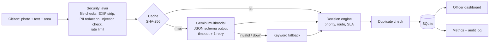

# 🛠️ Civic Issue Triage Agent

An AI agent that turns a citizen's **photo + short description** of a civic problem (pothole, garbage,
broken streetlight, water leak, fallen tree) into a **prioritised, routed, de-duplicated work order**
for municipal officers — securely, quickly and with a fallback that never stops working.

> Built for the hackathon theme *"what a well-engineered AI application can reliably accomplish"*.

## The problem
Municipal grievance portals receive thousands of unstructured complaints. Officers manually read each one,
guess the department, miss duplicates, and urgent hazards (live wires, open manholes) wait in the same
queue as minor litter. Citizens get no feedback.

**Users:** citizens (report), ward officers (act), administrators (monitor).

## What it does
1. **Citizen** uploads a photo, a description and the locality.
2. **Gemini (multimodal)** looks at the photo and text and returns *schema-validated JSON*:
   category, severity 1–5, hazard flag, summary, confidence.
3. **Deterministic decision engine** (plain Python, not the AI) computes a 0–100 priority score,
   P1–P4 label, department and SLA — every decision is explained.
4. **Duplicate detection** links repeat reports of the same issue in the same area and raises the
   original's priority instead of cluttering the queue.
5. **Officer dashboard** (PIN-protected) shows the queue highest-priority first; officers update status.
6. **Metrics page** shows latency, cache hit rate, fallback rate and a security audit log.

## Architecture


| Module | Responsibility |
|---|---|
| `src/security.py` | Input validation, EXIF/GPS removal, PII redaction, injection detection, rate limiting |
| `src/ai.py` | Gemini call with structured output, retry, timeout, rule-based fallback |
| `src/rules.py` | Priority score, labels, routing, SLA, explanations |
| `src/db.py` | Parameterised SQLite queries, cache, metrics, audit log |
| `src/pipeline.py` | Orchestrates the agent steps end to end |
| `app.py` | Streamlit UI (citizen, officer, metrics) |

## Security
- **Secrets** only in `.env` (git-ignored); `.env.example` documents them.
- **Uploads:** real file type checked with Pillow (not the extension), 5 MB and pixel limits
  (blocks decompression bombs), corrupted files rejected.
- **Privacy:** every image is re-encoded, which removes all metadata including **GPS location**;
  phone numbers, emails and Aadhaar-like numbers are **redacted** before storage or AI processing.
- **Prompt-injection defence:** citizen text is wrapped in `<citizen_report>` tags and the system
  instruction tells Gemini to treat it only as data; suspicious text is detected, flagged, logged,
  and **cannot raise priority** (its report goes to manual review).
- **AI output is never trusted blindly:** enforced JSON schema + Pydantic validation; enum categories
  and bounded severity mean the model cannot invent departments or scores.
- **Decisions in code, not in the LLM** — priority and routing are deterministic and tested.
- **SQL injection:** all queries parameterised.
- **Access control:** officer dashboard behind a PIN compared in constant time (`hmac.compare_digest`).
- **Abuse:** per-session rate limit (5 reports/min); duplicate boost capped so it can't be spammed.
- **Audit log** of logins, rejected inputs, flags and status changes. Errors shown to users are generic.

## Efficiency & performance
- **Cache:** identical image + text → served from SQLite, **0 API calls**.
- **Images downscaled** to 1024 px before sending → fewer tokens, lower latency.
- **One Gemini call per report** (structured output, no multi-turn chatter).
- **Timeout (20 s) + one retry + fallback** → the system always responds.
- Index on `(area_key, category, status)` for fast duplicate lookup.
- Live metrics: average latency, cache hit rate, fallback rate.

### Measured results
Run `python -m eval.run_eval` on 15 labelled reports (including one injection attempt) — results in
[`eval/results.md`](eval/results.md).

| Metric | Gemini | Rule-based fallback* |
|---|---|---|
| Category accuracy | _fill in_ | 100% |
| Hazard accuracy | _fill in_ | 80% |
| Median latency | _fill in_ | <1 ms |

\*The fallback's keywords were tuned on these same 15 samples, so its numbers are optimistic;
it exists to keep the service running, not to replace Gemini.

**21 automated tests** (`pytest`) cover upload validation, EXIF removal, PII redaction, injection
detection, rate limiting, scoring, routing, the full pipeline, and the Gemini path (valid output,
invalid JSON + retry, out-of-range values, timeouts, bad key without leaking it, caching) using a
fake client, so they run offline.

## Real vs sample data
- Every result shows where it came from: **AI analysis · Gemini**, **AI analysis · cached**, or
  **Rule-based estimate** (keyword fallback, shown with the reason Gemini wasn't used).
- **Load sample data** on the officer dashboard adds 6 made-up citizen reports marked **SAMPLE**.
  Only their *inputs* are fictional; their analysis, scoring, routing and duplicate detection are
  computed for real. **Remove sample data** deletes them.

## Google technology used
- **Gemini API** (`google-genai` SDK) — multimodal image + text understanding with
  **controlled generation** (`response_schema`) for reliable JSON.
- Key from **Google AI Studio**. Model configurable via `GEMINI_MODEL` (default `gemini-flash-latest`).

## Run locally (Windows, PowerShell or VS Code terminal)
```powershell
git clone https://github.com/shravanisy2006/civic-triage-agent.git
cd civic-triage-agent
python -m venv venv
venv\Scripts\activate
pip install -r requirements.txt
copy .env.example .env      # then put your Gemini key and an officer PIN in .env
streamlit run app.py
```
Git Bash: use `source venv/Scripts/activate` and `cp .env.example .env` instead.

- Tests: `pytest`
- Evaluation (writes `eval/results.md`): `python -m eval.run_eval`
- Without a key the app still works in rule-based mode.

### Troubleshooting
| Message in the app | Fix |
|---|---|
| "API key rejected" | Re-copy the key from aistudio.google.com into `.env`, restart the app |
| "Model ... not found" | Set `GEMINI_MODEL=gemini-2.5-flash` (or a model listed in AI Studio) in `.env` |
| "Free-tier rate limit reached" | Wait a minute; repeated reports are served from cache |
| "running scripts is disabled" (PowerShell) | `Set-ExecutionPolicy -Scope CurrentUser RemoteSigned` |

## Known limitations
- Officer access is a single shared PIN (adequate for a demo; production would use real accounts).
- Duplicate detection matches area text + category, not GPS coordinates.
- SQLite suits a single server; a multi-user deployment would move to a hosted database.

## Disclosure
Original code written for this hackathon. Uses open-source libraries: Streamlit, google-genai,
Pydantic, Pillow, python-dotenv, pandas, pytest. AI model: Google Gemini via API.
AI coding assistance (Claude) was used during development.
